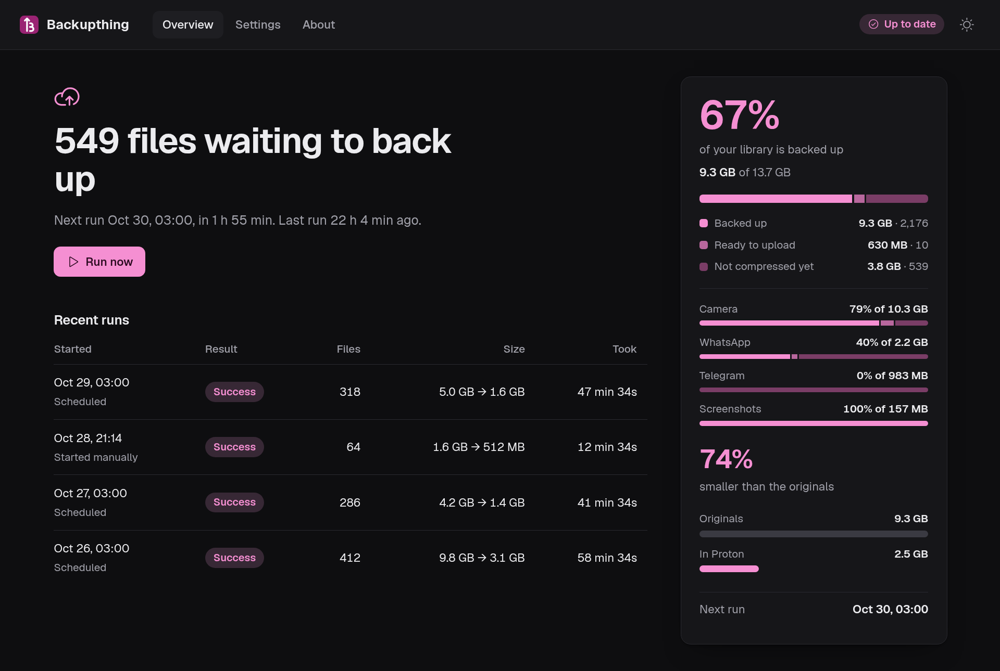
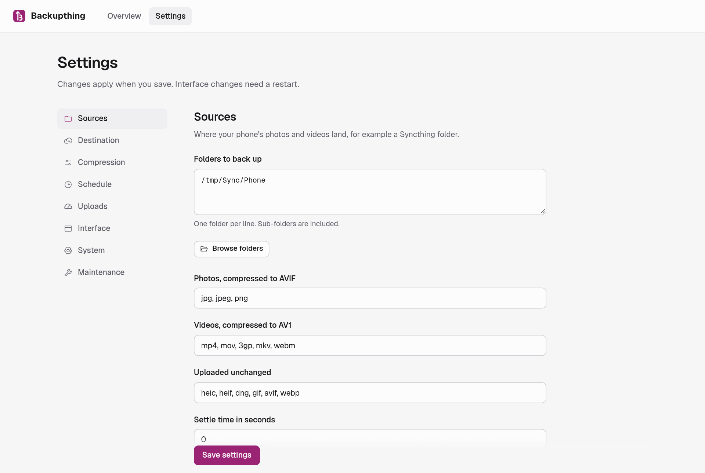

<p align="center"></p>

<h1 align="center">Backupthing</h1>

>I made Backupthing for personal use, so I could save my Proton Drive space by adding a compression layer. Made this public hoping it would be helpful for someone. I use this as a daily driver so I'll keep
>working on this actively, although other platform or cloud drive support won't be added unless I get some PRs. :)

Back up the photos and videos your phone syncs to your Linux PC, **compressed**, to
[Proton Drive](https://proton.me/drive). Photos become AVIF and videos become AV1, tuned to look the same
as the originals while usually taking a third to a half of the space. Only the compressed copies are
uploaded; your originals are never changed.



- **Visually lossless by default.** Video quality was calibrated with VMAF (≈97), photo quality by eye
  and SSIM. You can try any setting on one of your own files before saving.
- **Keeps what matters.** EXIF dates, time zone, GPS and orientation, Ultra HDR gain maps, video
  rotation, recording time and location all carry over. File dates are set so Proton shows the right
  capture time.
- **Hands-off.** Runs nightly (or every few hours, or only when you click *Run now*), catches up after
  the computer was off, and resumes cleanly after a crash, a reboot or a lost connection.
- **Uses your GPU** when it can (NVIDIA NVENC, Intel Quick Sync, VA-API), and falls back to the CPU.
- **Two destinations:** a folder tree in Proton Drive *My files*, or your Proton Photos timeline.
- **Web dashboard and settings**, a first-run setup wizard, and a Waybar module.
- **Easy on your connection:** an optional upload speed limit, plus daily and monthly upload caps.

## How it works

1. New or changed files in your source folders (for example the folder Syncthing puts your phone's
   camera roll in) are found and classified by content, not by folder name.
2. Photos are compressed with `avifenc`, videos with `ffmpeg`, into a private staging folder.
   Each result is checked (size, rotation, duration, audio). If compressing doesn't make a file
   smaller, the original is uploaded instead.
3. The compressed copy is uploaded with the official `proton-drive` command-line tool, and the staged
   copy is deleted once the upload is confirmed.

Nothing is ever deleted from Proton Drive, and nothing outside the staging folder is ever written.

## Requirements

- Linux with a systemd user session (for running as a service)
- Java 21 or newer
- `ffmpeg` and `ffprobe` with at least one AV1 encoder (`av1_nvenc`, `av1_qsv`, `av1_vaapi` or `libsvtav1`)
- `avifenc` (from libavif)
- The official [`proton-drive` CLI](https://proton.me/download/drive/cli/index.html), signed in
  (on Arch: `proton-drive-cli-bin` from the AUR)

`backupthing check` reports what it finds and which video encoders actually work on your machine.

## Install

**Release tarball:** download `backupthing-<version>.tar.gz` and its `.sha256` file from the
[releases page](https://github.com/tashilapathum/backupthing/releases), then check, unpack and install:

```sh
sha256sum -c backupthing-0.3.0.tar.gz.sha256
tar -xzf backupthing-0.3.0.tar.gz
./backupthing-0.3.0/install.sh
```

The installer needs no root. It puts Backupthing in `~/.local/opt` with the `backupthing` command in
`~/.local/bin`, starts it as a background service that starts again whenever you log in, adds
**Backupthing** to your app menu and opens the dashboard. To upgrade, do the same with the new version;
your settings and history are kept. `~/.local/opt/backupthing/install.sh --uninstall` removes it again,
and `--no-service` installs without the background service.

**Arch Linux (AUR):** install `backupthing-bin` (once published; the `PKGBUILD` is in `packaging/aur/`),
then start the service:

```sh
systemctl --user enable --now backupthing
```

## Quick start

Open the dashboard: **Backupthing** in your app menu, `backupthing open`, or http://127.0.0.1:8787.
The first time, a setup wizard checks the tools, signs you in to Proton (or run
`proton-drive auth login` yourself) and asks for your source folders, the destination and the schedule.
Everything can be changed later under **Settings**.



After that there is nothing to do: backups run on the schedule, and the dashboard shows progress,
savings and anything that failed. *Run now* starts a backup straight away.

### The background service

Backupthing runs as a systemd **user** service (it needs your session keyring for the Proton sign-in).
The tarball installer sets it up; with the package, enable it as shown above.

```sh
systemctl --user status backupthing
journalctl --user -u backupthing -f
```

If the keyring is still locked when a run starts (for example right after boot), uploads pause and the
dashboard says *Sign-in needed*; nothing is marked as failed, and the files upload on a later run.
Without systemd, run `backupthing serve` yourself instead.

### Waybar

`share/waybar/config.jsonc` (or `/usr/share/backupthing/waybar/` from the package) contains a module
that shows the status and progress, with details in the tooltip, plus an optional `image` module that
shows the Backupthing logo (`backupthing.svg`, white for dark bars). Clicking either opens the dashboard.
The data comes from `http://127.0.0.1:8787/api/waybar`; `/api/status` returns the full state as JSON.

## Configuration

Settings live in `~/.config/backupthing/config.toml` (or `$XDG_CONFIG_HOME`). The dashboard edits this
file for you; hand edits are picked up within a few seconds. A minimal example:

```toml
[sources]
roots = ["/home/you/Sync/Phone"]

[destination]
mode = "drive"                        # or "photos" for the Proton Photos timeline
remoteRoot = "/my-files/Backups/Phone"

[schedule]
mode = "daily"                        # "interval" or "manual"
dailyTime = "03:00"

[bandwidth]                           # optional; 0 means no limit
uploadLimitKBps = 2000                # 2 MB/s, shared by all uploads
dailyCapMB = 0
monthlyCapMB = 200000                 # 200 GB
monthResetDay = 1

[concurrency]                         # optional
stagingLimit = "files"                # or "size" (stagingMaxMB = 2000) or "none"
stagingMaxFiles = 10
```

The state database is `~/.local/share/backupthing/state.db` and staged files go to
`~/.cache/backupthing/staging/`. Compression pauses while the staging limit is reached and resumes as
uploads finish, so a slow connection or paused uploads don't fill your disk.

## Commands

| Command | What it does |
|---|---|
| `backupthing serve` | Scheduler and web dashboard (what the service runs) |
| `backupthing open` | Open the dashboard in the browser, starting the service if it isn't running |
| `backupthing run [--dry-run]` | One backup run, then exit. `--dry-run` compresses but doesn't upload |
| `backupthing check` | Tools, working encoders, Proton sign-in, configuration problems |
| `backupthing scan` | Record new and changed files without processing them |
| `backupthing --version` | Version |

`--config <file>` uses a different configuration file.
`run` exits with 0 on success, 1 if files failed or the run couldn't start, 3 if a Proton sign-in
is needed and 4 if Proton couldn't be reached.

## FAQ

**Are my originals safe?** Backupthing only reads them. All writing and deleting goes through one
guarded component that refuses any path outside its staging folder, and the test suite checks that
source files are byte-identical before and after a run.

**Drive folder or Photos timeline?** The Drive folder mirrors your folder structure and keeps versions
when a file changes. The Photos timeline sorts by capture date but has no versions, so a re-compressed
file appears a second time, and formats Photos doesn't accept (such as DNG) are reported as failed.

**What about motion photos?** By default only the still is compressed and uploaded; the short clip
stays in your original. Choose *Unchanged* to upload motion photos as they are.

**HEIC, DNG, GIF?** These are uploaded unchanged by default (HEIC is already efficient).

**How much space does it save?** In testing with Pixel files, photos shrank by about half and videos
by 55-88% depending on the scene. The dashboard shows your actual savings.

**I have an Intel or AMD GPU.** Quick Sync and VA-API are supported but haven't been tested on real
hardware yet, and their quality defaults are uncalibrated. If something fails, the file is retried on
the CPU. Reports and calibration results are very welcome.

**Can I open the dashboard from my phone?** Set *Listen on* to `0.0.0.0`, add an access token and the
host names you use. Other devices must then enter the token; this computer doesn't need it.

## Security

The dashboard can change which folders are read, so it is locked down even on localhost: it only
answers to known host names (blocking DNS rebinding), every change needs a per-session token and must
come from the dashboard's own origin, and a strict content security policy is set. Reaching it from
the network requires an access token.

## Contributing

See [CONTRIBUTING.md](CONTRIBUTING.md). Calibration results for Quick Sync and VA-API are especially
welcome.

## License

[GPL-3.0-or-later](LICENSE). Bundled third-party components are listed in
[THIRD_PARTY_NOTICES](THIRD_PARTY_NOTICES).
